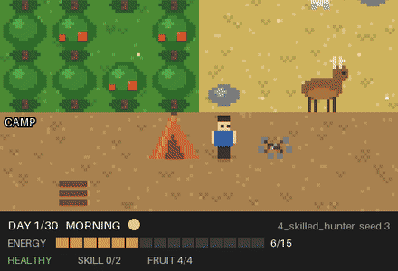
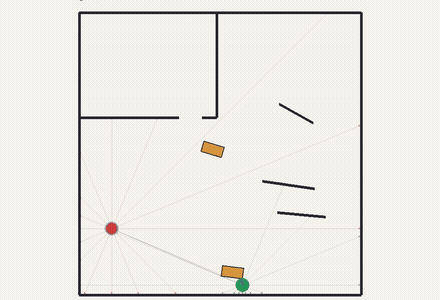
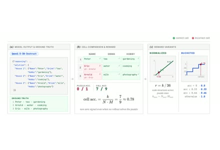
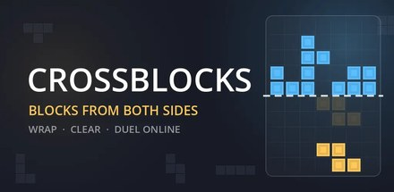
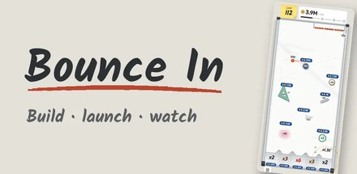
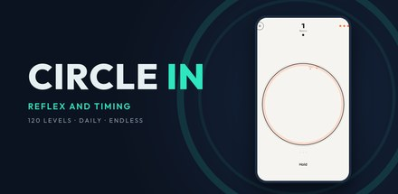
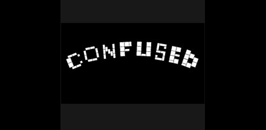

## Onur Kansoy

Computer Engineering · Izmir Institute of Technology 
Undergraduate researcher at the [Digital Humanities and Artificial Intelligence Laboratory](https://dbb.iyte.edu.tr/site_en.html), IZTECH

I put learning agents in small worlds and study what they invent, and what they fail to invent.
Most of my work is reinforcement learning environments I build myself, from single-agent survival to multi-agent cooperation.

I am interested in multi-agent reinforcement learning, emergent behaviour, social dilemmas, opponent modelling and game RL.

**[Website](https://anka256.github.io/onurkansoy/)** · [CV](https://anka256.github.io/onurkansoy/cv/) · [Hugging Face](https://huggingface.co/TheArchitect256) · [LinkedIn](https://linkedin.com/in/onurkansoy) · onurkansoy@std.iyte.edu.tr

 

### Research projects

<table>
<tr>
<td width="250"></td>
<td><b><a href="https://anka256.github.io/onurkansoy/research/hunter-gatherer/">Hunter-Gatherer Survival</a></b> · 2026, ongoing 
A Gymnasium environment I designed for the graduate RL course CENG567: an agent must survive 30 days by foraging, hunting and resting, with risky hunts, injuries and night danger. It started as a homework and keeps growing, now with multi-agent experiments. 
Python · Gymnasium · NumPy · tabular Q-learning, dynamic programming</td>
</tr>
<tr>
<td width="250"></td>
<td><b><a href="https://anka256.github.io/onurkansoy/research/hide-and-seek/">Hide and Seek</a></b> · 2026, paused 
A 1v1 continuous physics environment with raycast vision and movable boxes, trained from scratch with my own recurrent PPO and an asymmetric critic. The hider learned to stay out of sight; the seeker has not caught up yet. 
Python · PyTorch · self-play · recurrent PPO</td>
</tr>
<tr>
<td width="250"></td>
<td><b><a href="https://anka256.github.io/onurkansoy/research/smart-zebra/">Smart Zebra</a></b> · 2025 to 2026 
My senior thesis: a prompt-to-GRPO recipe for logic-grid reasoning in small language models. First author, funded by TÜBİTAK 2209-A, manuscript in revision. 
Qwen2.5-3B · SFT · GRPO · TRL</td>
</tr>
<tr>
<td colspan="2"><b><a href="https://github.com/Anka256/SocialJax/tree/recognition">Recognition</a></b> · 2026 
A very small personal experiment on a fork of <a href="https://github.com/cooperativex/SocialJax">SocialJax</a>: one environment where agents earn reward only by being recognised by others.</td>
</tr>
</table>

### Language models and agents

- [**Triage Master**](https://huggingface.co/TheArchitect256/qwen3.5-2b-triage-master): a small router model for multi-agent pipelines. Qwen3.5-2B fine-tuned with LoRA, 99.4% on a held-out test set.
- [**ToS Inspector**](https://chromewebstore.google.com/detail/tos-inspector/aajihdlemojmhiiacgakpkkmoocfpoik): a Chrome extension on the Chrome Web Store that reads Terms of Service for you and rates 7 risk categories with quotes as evidence. ([code](https://github.com/Anka256/ToS-Inspector))
- [**Stage Whisper**](https://huggingface.co/spaces/build-small-hackathon/stage-whisper): an interactive AI theatre engine for the Hugging Face Build Small Hackathon.
- [**Customer Support System**](https://github.com/Anka256/Customer-Support-System): a LangGraph ticket pipeline with prompt injection screening, classification, drafting and confidence scoring.
- [**GPT-Deep-Search**](https://github.com/Anka256/GPT-Deep-Search): a multi-agent researcher discovery system built with the OpenAI Agents SDK during my internship.
- Smaller projects: [Text2SQL Agent](https://github.com/Anka256/Text2SQL-Agent) · [PDF Chatbot](https://github.com/Anka256/Personal-PDF-Chatbot) · [Birdy](https://github.com/Anka256/Birdy) · [Knowledge Graph](https://github.com/Anka256/my-knowledge-graph)

### Games

<table>
<tr>
<td align="center" width="25%"> <b>Crossblocks</b> On Google Play</td>
<td align="center" width="25%"> <b>Bounce In</b> Testing</td>
<td align="center" width="25%"> <b>Circle In</b> In development</td>
<td align="center" width="25%"> <b>ConfUsed</b> Game jam, 2022</td>
</tr>
</table>

Crossblocks, Bounce In and Circle In are mobile games I make in Godot under the name 256 Games.
